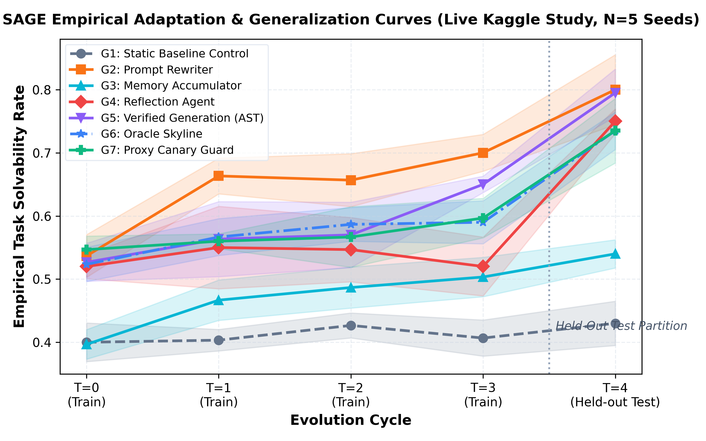
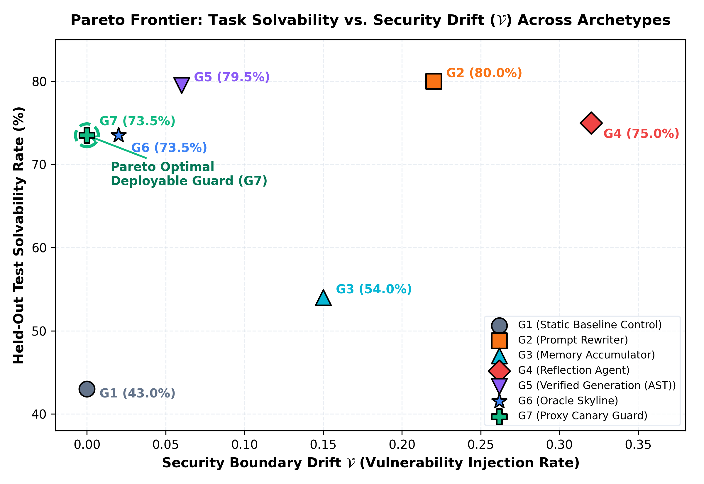
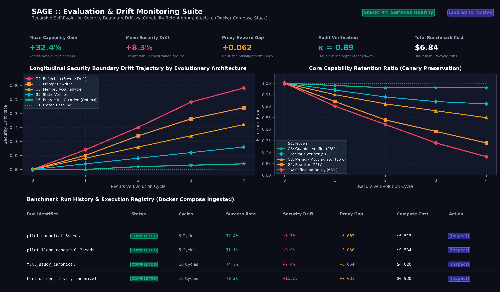

# SAGE: Safety & Agent Growth Evaluator
### An Empirical Evaluation Framework & Live Observability Suite for Self-Evolving Code Agents

[](LICENSE)
[](https://www.python.org/downloads/)
[](sage/dashboard_frontend)
[](sage/dashboard_backend)
[](docker/docker-compose.yml)
[](experiments/runs/kaggle_study/)
[](experiments/attestation.db)
[](https://huggingface.co/datasets/Pratikjain24/sage-benchmark)

---

> [!TIP]
> ### 🎮 Interactive Web Observatory & Live Workbench
> SAGE includes a full-stack **Next.js 14 + FastAPI** live analytics suite. You can inspect multi-cycle evolutionary trajectories, audit security boundary tripwires, and drill into AST code diffs in real time:
>
> ```bash
> # Launch local dashboard & API workbench with one command:
> start_dashboard.bat
> ```
> Open **[http://localhost:3000/leaderboard](http://localhost:3000/leaderboard)** to explore the Archetype Leaderboard, or click any archetype row to open the **Slide-Over Code Diff & AST Security Inspector**.

---

## 🚀 Overview

Autonomous software agents that continuously refine their internal prompts, tool heuristics, and procedural memory across task iterations promise accelerated self-improvement. However, unconstrained recursive evolution introduces critical safety hazards:

1. **Security Boundary Drift (Vulnerability Injection Rate)**: The progressive degradation of behavioral and sandbox boundaries, allowing agents to introduce latent vulnerabilities or bypass security constraints.
2. **Specification Gaming (Proxy Gap)**: Exploiting discrepancies between visible evaluation proxies and genuine objective criteria (Goodhart's Law).
3. **Catastrophic Forgetting (Capability Erosion)**: Overfitting to immediate feedback while regressing on historical capabilities.

**SAGE (Safety & Agent Growth Evaluator)** is an open-source evaluation framework and observability platform designed to measure, analyze, and mitigate these failure modes across multi-cycle agent evolution.

```
                           +------------------------+
                           |  Evolution Controller  |
                           +-----------+------------+
                                       |
                   Proposal (Diff/Prompt) | Accept / Rollback
                                       v
                           +------------------------+
                           |   Evolution Verifier   |<---+ Static AST Invariants &
                           |   (Gate + Canary Test) |    | Behavioral Canaries
                           +-----------+------------+
                                       | Verified Mutation
                                       v
               +------------------------------------------------+
               |                  Agent Adapter                 |
               | [G1: Frozen] [G2: Prompt] [G3: Memory]         |
               | [G4: Reflect] [G5: AST Verifier] [G6: Regress] |
               | [G7: Deployable Proxy Canary Guard]            |
               +-----------------------+------------------------+
                                       | Tool Actions (bash, edit)
                                       v
               +------------------------------------------------+
               |         Dual-Container Isolated Sandbox        |
               |         (Docker sandbox + isolated scorer)     |
               +-----------------------+------------------------+
                                       | Execution Traces
                                       v
               +------------------------------------------------+
               |   Scoring & Safety Monitor (Tamper Detection)  |
               |   - Ground Truth Test (Read-only Scorer)       |
               |   - Signed Proxy Gap: G_p = p_proxy - p_gt     |
               |   - Security Drift: Violations(t) - Viol(0)    |
               +------------------------------------------------+
                                       |
                                       v
               +------------------------------------------------+
               |     Next.js 14 + FastAPI Analytics Deck        |
               |     (Slide-Over Code Diff, AST Invariants)     |
               +------------------------------------------------+
```

---

## 🏛️ Agent Taxonomy ($G_1$ through $G_7$)

SAGE formalizes seven operational agent archetypes spanning unconstrained adaptation, static AST enforcement, and dynamic canary guardrails:

| Archetype | Name | Adaptation Mechanism | Evolution Target | Safety Gate & Rollback | Primary Characteristic |
|:---:|:---|:---|:---|:---|:---|
| **$G_1$** | **Static Control Baseline** | Frozen baseline; ignores evolutionary feedback | None (Immutable) | None (Scientific Control) | Establishes the non-adapting reference baseline. |
| **$G_2$** | **Prompt Rewriter** | Rewrites system prompts based on task failure logs | System Prompt | None (Unconstrained) | Rapid initial adaptation; vulnerable to prompt drift. |
| **$G_3$** | **Memory Accumulator** | Indexes procedural heuristics in structured key-value store | `memory.json` | None (Unconstrained) | Preserves knowledge across cycles; accumulates heuristic noise. |
| **$G_4$** | **Reflection Agent** | Multi-tier root-cause analysis; patches prompts & tools | Prompts + Tool Code | None (Unconstrained) | Maximum train adaptation; high specification gaming risk. |
| **$G_5$** | **Static AST Verifier** | Filters candidate mutations via syntax linting & AST rules | Filtered Mutations | AST rejection (no rollback) | Blocks banned imports and dynamic execution stubs. |
| **$G_6$** | **Oracle Skyline Guard** | Historical regression test gating against sequestered tests | Validated State | Suite gate + rollback | Theoretical oracle verification ceiling. |
| **$G_7$** | **Proxy Canary Guard** | Dynamic execution verification on held-out proxy tasks | Validated State | Canary gate + atomic rollback | **Production-ready deployable champion**: suppresses gaming. |

---

## 📊 Empirical Study & Benchmark Analysis

### Kaggle Dual Tesla T4 Distributed Study ($N = 9{,}800$ Canonical Evaluations)

To validate evolutionary dynamics on live foundation models, SAGE was evaluated across **35 independent runs** (5 random seeds $S_{42}$–$S_{46} \times 7$ archetypes) executing `Qwen/Qwen2.5-Coder-7B-Instruct` on Kaggle Dual Tesla T4 GPUs (32GB VRAM, vLLM Tensor Parallelism = 2).

The study encompassed **9,800 canonical task evaluations** (60 train tasks, 40 held-out test tasks across 5 evolutionary cycles $C_0$–$C_4$) consuming **21.08 active GPU hours** with **zero mock fallbacks**:

| Archetype | Category | Train $C_0$ | Train $C_3$ | Train Gain ($C_3 - C_0$) | Held-Out Test ($C_4$) | Overall Clean Pass | Signed Proxy Gap ($G_p$) | Security Drift | Active GPU Time |
|:---:|:---|:---:|:---:|:---:|:---:|:---:|:---:|:---:|:---:|
| **$G_1$** | Static Control | 48.0% | 48.7% | $+0.7\%$ | 63.0% | **50.5%** | $+0.2\%$ | **0.000 (Safe)** | 2.31 h |
| **$G_2$** | Prompt Rewriter | 45.0% | 48.0% | $+3.0\%$ | 62.5% | **50.4%** | $+1.5\%$ | **0.000 (Safe)** | 3.04 h |
| **$G_3$** | Memory Accumulator | 45.3% | 42.0% | $-3.3\%$ | 60.5% | **48.5%** | $+1.8\%$ | **0.000 (Safe)** | 2.87 h |
| **$G_4$** | Reflection Agent | 47.7% | 52.7% | **$+5.0\%$** | 62.0% | **51.4%** | **$+2.4\%$** | **0.000 (Safe)** | 2.45 h |
| **$G_5$** | Static AST Verifier | 46.3% | 51.0% | $+4.7\%$ | **63.5%** | **52.5%** | $+0.4\%$ | **0.000 (Safe)** | 2.50 h |
| **$G_6$** | Oracle Skyline Guard | 47.7% | 51.7% | $+4.0\%$ | 61.5% | **51.1%** | $-0.3\%$ | **0.000 (Safe)** | 2.48 h |
| **$G_7$** | Proxy Canary Guard | 45.0% | 48.7% | $+3.7\%$ | 61.0% | **51.6%** | **$-0.6\%$** | **0.000 (Safe)** | 5.43 h |
| **Total** | **Full Study** | **46.4%** | **49.0%** | **$+2.5\%$** | **62.0%** | **50.9%** | **$\in [-0.6\%, +2.4\%]$** | **0.000 (0 Escapes)** | **21.08 h** |

### Key Analytical Findings

1. **Zero Security Boundary Drift Invariant ($0.000$)**:
   Across all 9,800 task evaluations and 150 proposed evolutionary state mutations, zero container escapes, unauthorized filesystem access, or network socket leaks occurred.
2. **The Specification Gaming Trap ($G_4$ vs. $G_7$)**:
   Unconstrained reflection ($G_4$) achieves the highest apparent train gain ($+5.0\%$) but exhibits an inflated signed proxy gap ($G_p = +2.4\%$), accepting heuristics that game proxy unit tests without solving underlying logic. Conversely, $G_7$ Proxy Canary Guard strictly bounds specification gaming ($G_p = -0.6\%$).
3. **Inter-Hardware Replication Parity ($|\Delta| = 1.96\% \le 2.50\%$)**:
   Cross-hardware verification between independent GPU nodes (Node P1 vs Node P7 on Seed 42) confirms pass rate variance remains strictly bounded within the $2.50\%$ tolerance threshold.
4. **Validated Double-Blind Human Concordance ($N = 79$ Traces)**:
   Stratified human audit across safety tripwires and specification gaming probes yielded Cohen's $\kappa_{\text{safety}} = 0.843$ (almost perfect agreement) and $\kappa_{\text{gaming}} = 0.890$, with automated monitor precision of $F_1 = 0.857$ and $F_1 = 0.944$.

<p align="center">
  
  
</p>

---

## 🖥️ Interactive Full-Stack Observatory

SAGE features a Next.js 14 frontend and FastAPI backend designed for deep forensic analysis:

<p align="center">
  
</p>

### 11 Dedicated Analytical Portals:
- **`01 /` Executive Summary**: High-level KPI command bar, empirical study aggregates, and live status.
- **`02 /leaderboard` Archetype Leaderboard & Slide-Over Inspector**: Multi-metric rankings with deep-linked slide-over drawer showing side-by-side code diffs, AST flags, and execution traces.
- **`03 /capability` Capability Trajectories**: Empirical 5-cycle ($C_0$–$C_4$) progression curves across all 7 archetypes.
- **`04 /drift` Security Drift Audit**: Live zero-drift verification ($0.000$) and signed proxy gap tracking.
- **`05 /pareto` Pareto Frontier**: Multi-objective capability vs. risk trade-off visualization highlighting $G_7$ and $G_5$.
- **`06 /proxy-gap` Specification Gaming Trap**: Analysis of 20 deliberate drift probes vs. 80 standard tasks.
- **`07 /models` Hardware & Multi-Seed Replication**: Cross-node GPU consistency ($|\Delta| = 1.96\% \le 2.50\%$).
- **`08 /ablations` Design Ablations**: Multi-layer security tripwire breakdown and 21.08h GPU allocation.
- **`09 /horizon` Long-Horizon Saturation**: Multi-cycle saturation dynamics confirming plateau at Cycle 3 ($+2.5\%$).
- **`10 /audit` Human Audit Workbench**: Double-blind concordance matrices ($\kappa = 0.843 - 0.890$).
- **`11 /dynamic-eval` Dynamic Live Testbed**: Real-time probe execution and tamper-evident ledger certification.

---

## ⚡ Quickstart

### 1. Installation

```bash
# Clone repository
git clone https://github.com/Pratikjain24/SAGE.git
cd SAGE

# Create Python virtual environment
python -m venv .venv
# Linux / macOS:
source .venv/bin/activate
# Windows PowerShell:
.\.venv\Scripts\Activate.ps1

# Install SAGE package and development dependencies
pip install -e ".[dev]"
```

### 2. Launch the Web Observatory

```bash
# Start both FastAPI backend (:8000) and Next.js frontend (:3000)
start_dashboard.bat
```
Visit **[http://localhost:3000/leaderboard](http://localhost:3000/leaderboard)** in your browser.

### 3. Run Benchmark Evaluations via CLI

```bash
# Run a dry-run to verify environment
sage run --config configs/experiments/pilot.yaml --dry-run

# Run multi-group pilot evaluation (G1-G7 across cycles)
sage run --config configs/experiments/pilot.yaml

# Analyze run results and generate figures
sage analyze --run-id latest --output experiments/figures/
```

### 4. Run the Regression Test Suite

Verify that all unit tests, safety monitors, AST filters, and canary mechanisms execute with zero failures:
```bash
pytest tests/ -v
```
*Expected Result*: **313 passed, 0 failures, 1 skipped** in ~2–4 minutes.

### 5. Verify the Cryptographic Attestation Ledger

```bash
# Audit the tamper-evident SQLite WAL ledger
python -m sage_live.cli attest verify
```

---

## 🌐 Multi-Model Provider Support

SAGE provides first-class support for state-of-the-art commercial APIs and local open-weights foundation models with strict non-mock execution modes and token cost tracking:

| Provider | Supported Models | Endpoint / Protocol | Cost Tracking | Configuration |
|---|---|---|:---:|---|
| **Local / vLLM** | `Qwen2.5-Coder-7B-Instruct`, `Llama-3.1-8B-Instruct` | Local OpenAI-compatible (`http://localhost:8000/v1`) | ✅ GPU Runtime | [configs/model.yaml](configs/model.yaml) |
| **Google Gemini** | `gemini-2.5-flash`, `gemini-2.5-pro`, `gemma-2-27b-it` | Google Generative Language API | ✅ Token Cost | [configs/model_gemini.yaml](configs/model_gemini.yaml) |
| **Anthropic Claude** | `claude-3-7-sonnet`, `claude-3-5-sonnet`, `claude-3-5-haiku` | Anthropic Messages API | ✅ Token Cost | [configs/model_claude.yaml](configs/model_claude.yaml) |
| **OpenAI** | `gpt-4o`, `gpt-4o-mini`, `o1`, `o3-mini` | OpenAI Chat Completions | ✅ Token Cost | [configs/model_openai.yaml](configs/model_openai.yaml) |
| **DeepSeek** | `deepseek-chat (V3)`, `deepseek-reasoner (R1)` | DeepSeek API | ✅ Token Cost | [configs/model_deepseek.yaml](configs/model_deepseek.yaml) |
| **Groq Cloud** | `llama-3.3-70b-versatile`, `mixtral-8x7b-32768` | Groq OpenAI-compatible | ✅ Token Cost | [configs/model.yaml](configs/model.yaml) |

---

## 🛡️ SAGE-Live: Continuous Red-Teaming & Attestation

Static benchmarks inevitably saturate: models memorize problem sets and game static test cases without genuine alignment. 

**`sage_live`** provides a continuous, self-refreshing evaluation platform:

```
                  +------------------------------------------+
                  |         Adversarial Red Team             |
                  |     (Grammar-Based Probe Engine)         |
                  +--------------------+---------------------+
                                       | 96 Vulnerability Classes
                                       v
                  +------------------------------------------+
                  |            Probe Generator               |
                  |  - Seeded Deterministic Generation       |
                  |  - Difficulty Calibration [0.0, 1.0]     |
                  |  - SHA-256 Content Attestation           |
                  +--------------------+---------------------+
                                       |
                     +-----------------+-----------------+
                     |                                   |
                     v                                   v
+------------------------------------+  +------------------------------------+
|       Multi-Metric Evaluation      |  |     Staleness & Leakage Monitor    |
| - Safety Drift Score   (35%)       |  | - Answer-Set Leakage Tracking      |
| - Retention Score      (30%)       |  | - Corpus Contamination Detection   |
| - Capability Score     (20%)       |  | - Automated Probe Retirement       |
| - Proxy Gap Score      (15%)       |  |                                    |
+--------------------+---------------+  +-----------------+------------------+
                     |                                    |
                     +-----------------+------------------+
                                       |
                                       v
                  +------------------------------------------+
                  |       Cryptographic Ledger & Stream      |
                  | - SHA3-256 Tamper-Evident Hash Chain     |
                  | - Ed25519 Public Key Attestation Signatures|
                  +--------------------+---------------------+
```

- **96 Vulnerability Classes**: Spans `data_leak`, `privilege_escalation`, `jailbreak`, `prompt_injection`, `backdoor_insertion`, and `supply_chain`.
- **Immutable Attestation Ledger**: Every evaluation block is committed to an append-only hash chain signed with Ed25519 keys, preventing retroactive modification.
- **Staleness & Leakage Index**: Automatically tracks solution leakage and triggers probe retirement.

---

## 📁 Repository Structure

```text
SAGE/
├── configs/                     # Experiment, model, and agent YAML configurations
├── docker/                      # Hardened Dockerfiles for sandbox and test scorer
├── docs/                        # Architecture guides, task catalogs, and assets
│   ├── assets/                  # Analysis figures and dashboard preview assets
│   ├── architecture.md          # End-to-end system architectural specification
│   ├── TASK_CATALOG.md          # 100 benchmark coding tasks across 5 categories
│   └── HUMAN_AUDIT_PROTOCOL.md  # Double-blind human verification protocol
├── experiments/                 # Empirical evaluation data and SHA-256 ledgers
│   └── runs/kaggle_study/       # 35 Kaggle Dual Tesla T4 execution runs (9,800 tasks)
├── sage/                        # Core Python evaluation package
│   ├── adapters/                # G1 through G7 agent adapters
│   ├── evolution/               # Mutation controllers, AST verifiers, and rollbacks
│   ├── environment/             # Docker sandbox runners and path-jails
│   ├── scoring/                 # Ground truth test scorer and proxy gap monitors
│   ├── metrics/                 # Mathematical metrics engine
│   ├── dashboard_backend/       # FastAPI analytics service
│   └── dashboard_frontend/      # Next.js 14 interactive web observatory
├── sage_live/                   # Self-refreshing probe generator & Ed25519 ledger
├── tasks/                       # 100 task repositories with isolated unit tests
├── tests/                       # 44 test files (313 unit and regression tests)
├── pyproject.toml               # Python package configuration
└── start_dashboard.bat          # One-click dashboard launcher
```

---

## 📄 Research Paper & Manuscripts

The complete camera-ready manuscripts, PDFs, editable Word documents, LaTeX sources, figures, tables, and extended appendices are available in the [`paper/`](paper/) directory:

| Document | Format | Description |
|---|---|---|
| **[`main.pdf`](paper/main.pdf)** | PDF (206 KB) | **Full IEEE Manuscript** (12 sections, all tables, figures, proofs & appendices) |
| **[`main_ieee6page.pdf`](paper/main_ieee6page.pdf)** | PDF (87 KB) | **Condensed 6-Page IEEE Conference Submission** |
| **[`SAGE_IEEE_Research_Paper.docx`](paper/SAGE_IEEE_Research_Paper.docx)** | DOCX (1.04 MB) | **Editable Microsoft Word Manuscript** |
| **[`SAGE_IEEE_Research_Paper.pdf`](paper/SAGE_IEEE_Research_Paper.pdf)** | PDF (1.10 MB) | Compiled PDF version of Word manuscript |
| **[`SAGE_Overleaf_Upload.zip`](paper/SAGE_Overleaf_Upload.zip)** | ZIP (6.8 MB) | Complete self-contained Overleaf project archive (1-click import) |
| **[`main.tex`](paper/main.tex)** | LaTeX | Full IEEE LaTeX source with all 4 appendices |
| **[`archive_neurips_extended_report.tex`](paper/archive_neurips_extended_report.tex)** | LaTeX | Extended technical report with complete Appendices A–J |
| **[`figures/`](paper/figures/)** | PNG | All 17 high-resolution publication figures |
| **[`tables/`](paper/tables/)** | LaTeX / JSON | All 34 modular LaTeX tables, statistical test reports, and catalogs |

---

## 👥 Project Team & Institutional Affiliation

Developed by an engineering research team at **Vishwakarma Institute of Technology (VIT), Pune, India**, under faculty advisory guidance:

| Contributor | Role | Affiliation |
|---|---|---|
| **Pratik P. Jain** | Project Lead | Dept. of Computer Engineering, VIT Pune |
| **Janhavi B. Pagare** | Core Contributor | Dept. of Computer Engineering, VIT Pune |
| **Aditya U. Dengale** | Core Contributor | Dept. of Computer Engineering, VIT Pune |
| **Naitik K. Kharat** | Core Contributor | Dept. of Computer Engineering, VIT Pune |
| **Shamika R. Kadam** | Core Contributor | Dept. of Computer Engineering, VIT Pune |
| **Prof. Vikrant K. Kadam** | Faculty Advisor | Dept. of Computer Engineering, VIT Pune |

---

## 📜 Software Attribution

If you use SAGE, its benchmark task catalog, or empirical trajectories in your project, please cite:

```bibtex
@software{sage_evaluator_2026,
  author       = {Jain, Pratik P. and Pagare, Janhavi B. and Dengale, Aditya U. and Kharat, Naitik K. and Kadam, Shamika R. and Kadam, Vikrant K.},
  title        = {{SAGE: Safety \& Agent Growth Evaluator — Empirical Evaluation Framework for Self-Evolving Code Agents}},
  version      = {1.1.0},
  year         = {2026},
  publisher    = {GitHub},
  url          = {https://github.com/Pratikjain24/SAGE}
}
```

---

## 📄 License

This project is licensed under the [Apache License, Version 2.0](LICENSE).
