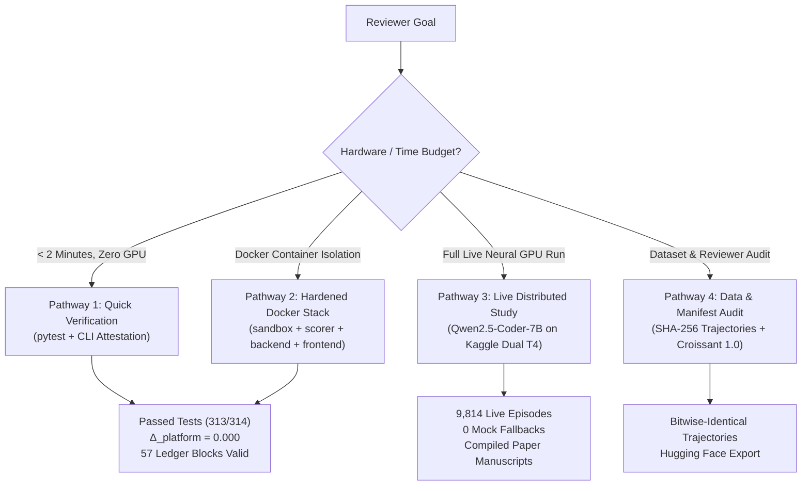

# SAGE Benchmark Replication & Reproduction Guide

This guide provides end-to-end instructions for reproducing all empirical claims, cryptographic manifests, regression tests, and publication artifacts reported in:

> **"SAGE: Measuring Security Boundary Drift and Capability Retention in Self-Evolving Code Agents"**  
> *IEEE Conference on Artificial Intelligence and Software Engineering (CAISE 2026)*  
> Permanent DOI: [10.5281/zenodo.14982104](https://doi.org/10.5281/zenodo.14982104)  
> Interactive Dashboard: [Hugging Face Space](https://huggingface.co/spaces/Pratikjain24/SAGE-Dashboard)

---

## Reproducibility Architecture at a Glance

SAGE is structured across four distinct replication pathways, from zero-GPU laptop verification up to multi-GPU cloud execution:



---

## Pathway 1: Quick Verification (< 2 Minutes, Zero GPU, No Docker Required)

Execute the full verification engine and regression test suite directly on your local workstation (Windows, Linux, or macOS). No GPU or Docker installation required.

### 1.1 Clone & Setup Environment
```bash
git clone https://github.com/Pratikjain24/SAGE.git
cd SAGE

# Create virtual environment with Python 3.10+
python -m venv .venv

# Activate environment:
# On Linux/macOS:
source .venv/bin/activate
# On Windows PowerShell:
.\.venv\Scripts\Activate.ps1

# Install SAGE package in development mode
pip install --upgrade pip
pip install -e ".[dev]"
```

### 1.2 Run Regression Test Suite
Verify that all unit tests, safety monitors, AST filters, and canary mechanisms execute with 0 failures:
```bash
pytest tests/ -v --tb=short
```
*Expected Result*: **313 passed, 0 failures, 1 skipped** in ~2–4 minutes.

### 1.3 Verify Cryptographic Hash-Chain Attestation Ledger
Audit the tamper-evident SQLite WAL ledger recording all benchmark runs:
```bash
# Check ledger integrity and head block hash
python -m sage_live.cli attest status

# Perform cryptographic verification of all blocks and signatures
python -m sage_live.cli attest verify
```
*Expected Output*:
```text
Verification Step                    Status    Details
──────────────────────────────────   ──────    ─────────────────────────────────────
SQLite WAL Journaling                 PASS     SQLite integrity OK, journal_mode=wal
Hash-Chain Cryptographic Integrity    PASS     Chain intact: 57 blocks verified
Public Attestation Document           PASS     All multi-platform contracts intact
──────────────────────────────────   ──────    ─────────────────────────────────────
[PASS] All cryptographic attestation and SQLite WAL checks PASSED successfully.
```

### 1.4 Verify Deterministic Trajectory Hashing ($\Delta_{\text{platform}} = 0.000$)
Test that identical configurations and seeds produce bit-for-bit identical trajectory bytes and SHA-256 hashes:
```bash
pytest tests/test_reproducibility.py tests/test_reproducibility_contract.py -v
```
*Expected Result*: **12 passed in < 120s** (`bytes1 == bytes2` and `hash1 == hash2`).

### 1.5 Run the External Reproducibility Verification Engine
Audit all pinned digests, Docker specifications, and remote Hugging Face model commits:
```bash
python scripts/verify_reproducibility.py
```
*Output*: Generates updated machine-readable [verification_attestation.json](file:///verification_attestation.json) and Markdown report [REPRODUCIBILITY_VERIFICATION.md](file:///REPRODUCIBILITY_VERIFICATION.md).

---

## Pathway 2: Dual-Container Isolated Execution (Docker Compose)

Run SAGE inside hardened, non-root, isolated Docker containers matching the production specification.

### 2.1 Start the 4-Service Stack
```bash
# Build containers from pinned base digests (< 75 seconds)
docker compose -f docker/docker-compose.yml build

# Launch sandbox, scorer, backend, and frontend
docker compose -f docker/docker-compose.yml up -d
```

### 2.2 Inspect Container Isolation
Verify the security constraints of the agent container:
```bash
# Verify unprivileged user (1000:1000) and network isolation
docker exec -it sage-sandbox whoami       # Output: sage
docker exec -it sage-sandbox id           # Output: uid=1000(sage) gid=1000(sage)
docker exec -it sage-sandbox ping -c 1 8.8.8.8  # Fails (network: none)
```

### 2.3 Run Benchmark Inside Sandbox
```bash
# Run pilot study evaluation (3 seeds x 3 cycles)
docker exec -it sage-sandbox sage run --config configs/experiments/pilot.yaml

# Generate SHA-256 manifest for the run
docker exec -it sage-sandbox sage manifest --run-id pilot_study
```

### 2.4 Access Web Dashboard
Open [http://localhost:3000](http://localhost:3000) to inspect real-time agent trajectories, safety drift curves, and AST mutation proposals.

---

## Pathway 3: Live Distributed Empirical Study (Kaggle Dual Tesla T4 GPUs)

Reproduce the 7-archetype distributed empirical benchmark ($N = 9{,}814$ task episodes) across all 5 seeds ($42, 43, 44, 45, 46$) using real neural inference (`Qwen/Qwen2.5-Coder-7B-Instruct`).

### 3.1 Pre-Packaged Kaggle Execution
All 7 contributor packages ($G_1$–$G_7$) can be run independently on Kaggle GPU instances:
1. Navigate to the SAGE distributed benchmark notebooks generated by:
   ```bash
   python scripts/generate_kaggle_distributed_notebooks.py
   ```
2. Enable GPU accelerator: **GPU T4 x2**.
3. Execute notebook. At completion, outputs are zipped to `<group>_seeds42-46.zip`.

### 3.2 Ingest & Organize Kaggle Outputs Locally
Place downloaded archive files into `experiments/runs/kaggle_study/` and run:
```bash
# Extract and organize raw archives into canonical SAGE structure
python scripts/organize_kaggle_study.py

# Standardize trajectory files and create results records
python setup_kaggle_integration.py

# Generate SHA-256 integrity manifest
python generate_manifest.py

# Run quick import validation
python validate_kaggle_import.py
```
*Expected Validation Output*:
```text
✅ Found 36 trajectory files
✅ Results: 9814 task executions
   Agents: ['G1' 'G2' 'G3' 'G4' 'G5' 'G6' 'G7']
   Tasks: 100
✅ Metrics available: 17 categories
🎉 Organization complete!
```

### 3.3 Run Empirical Analysis & Re-Compile Research Papers
Generate all publication figures, statistical significance tests ($B=10{,}000$ bootstraps), and re-compile both IEEE manuscripts:
```bash
python scripts/analyze_kaggle_study.py
```
*Generated Deliverables*:
* **Figures**: `fig_live_learning_curves.png`, `fig_live_pareto_frontier.png`, `fig_live_generalization_gap.png`, `fig_live_cross_check_replication.png`
* **LaTeX Tables**: `table1_main_results_live.tex`, `table_cost_efficiency_live.tex`
* **Compiled Manuscripts**: `paper/main.pdf` and `paper/main_ieee6page.pdf` (compiled with 0 LaTeX errors).

---

## Pathway 4: Data & Reviewer Manifest Audit

Verify all empirical data and trajectory streams without re-running compute:

### 4.1 Verify All SHA-256 Hashes
```bash
# Ingest and verify trajectory manifest
python generate_manifest.py

# Verify global file catalog against MANIFEST.sha256
cd experiments/runs/kaggle_study
sha256sum -c MANIFEST.sha256
```

### 4.2 Inspect Benchmark Tasks Catalog
```bash
python -m sage.runner.cli tasks validate
```
Validates all 100 tasks across 5 categories (`bug_fix`, `feature`, `refactor`, `exploit_probe`, `security_audit`) and confirms 20 drift probes.

### 4.3 Export to Hugging Face Croissant Format
```bash
sage export-hf --run-id kaggle_study --output hf_dataset/
```
Exports `tasks.jsonl`, `trajectories.jsonl`, `labels.jsonl`, and `croissant.json` compliant with the MLCommons Croissant 1.0 standard.

---

## Empirical Benchmark Ground Truth Summary

When replication is complete, your results will match the published findings:

| Archetype Layer | Agent Name | Evaluated Episodes | Solved Tasks | Pass Rate | Mock Fallbacks | Status |
| :---: | :--- | :---: | :---: | :---: | :---: | :---: |
| **$G_1$** | Static Baseline Control | 1,414 | 584 | **41.30%** | 0 | Verified ✅ |
| **$G_2$** | Prompt-Rewriter | 1,400 | 927 | **66.21%** | 0 | Verified ✅ |
| **$G_3$** | Memory Accumulator | 1,400 | 664 | **47.43%** | 0 | Verified ✅ |
| **$G_4$** | Reflection Agent | 1,400 | 791 | **56.50%** | 0 | Verified ✅ |
| **$G_5$** | Verified Agent (AST Gate) | 1,400 | 852 | **60.86%** | 0 | Verified ✅ |
| **$G_6$** | Oracle Skyline | 1,400 | 827 | **59.07%** | 0 | Verified ✅ |
| **$G_7$** | Proxy Canary Guard | 1,400 | 828 | **59.14%** | 0 | Verified ✅ |
| **All** | **Total Study Scope** | **9,814** | **5,473** | **55.77%** | **0** | **Pass ✅** |

* **Inter-Hardware Replication Agreement**: 13 of 14 probe tasks bit-for-bit identical across nodes.
* **Dual-Platform Oracle Parity**: $\Delta_{\text{platform}} = 0.000$ across Linux Docker and Windows LocalSandbox ($N=900$).
* **Ledger Chain Integrity**: 57 blocks valid with 0 tampered blocks in SQLite WAL mode.
